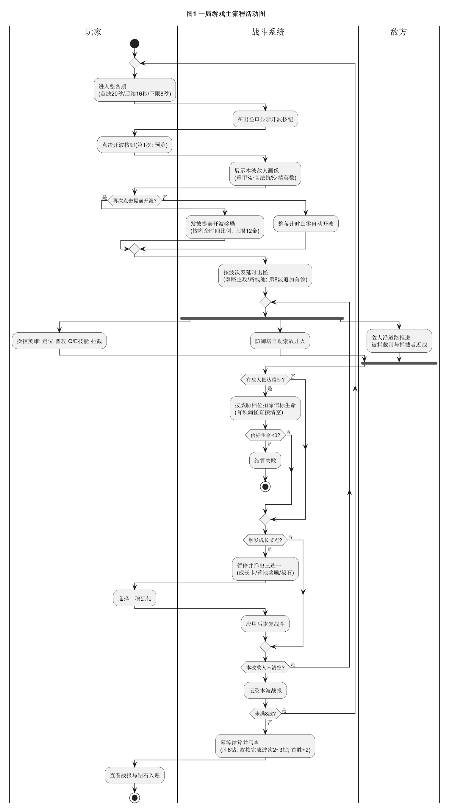
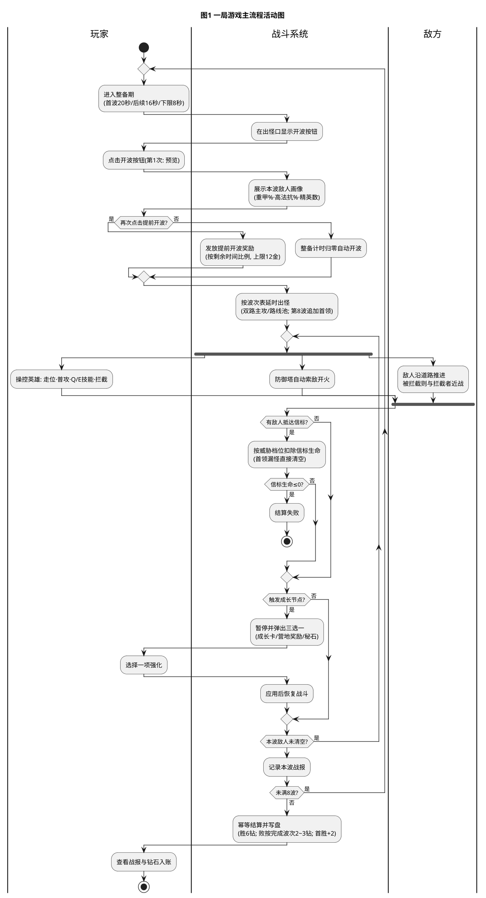
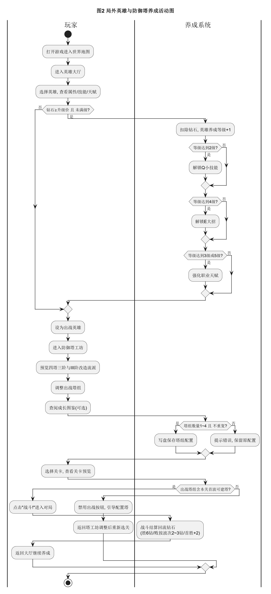
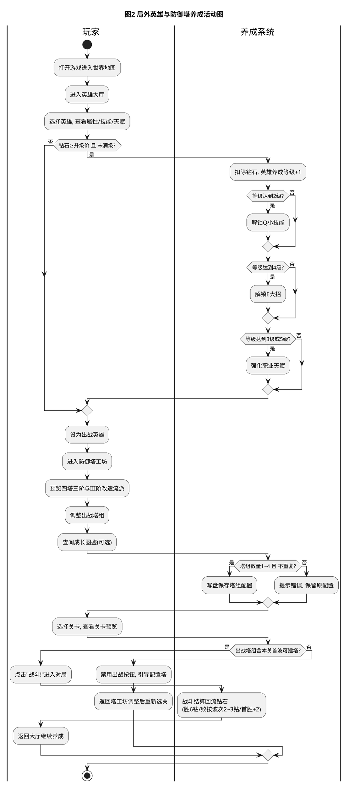
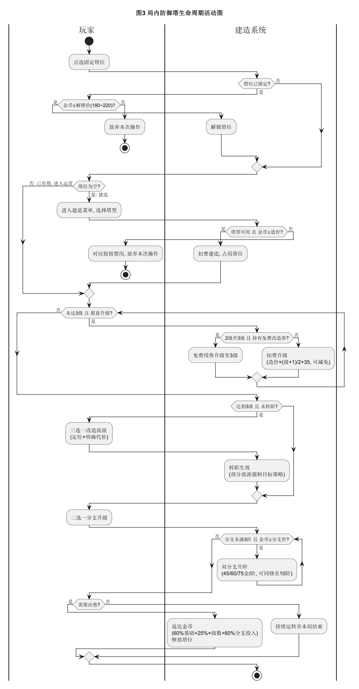
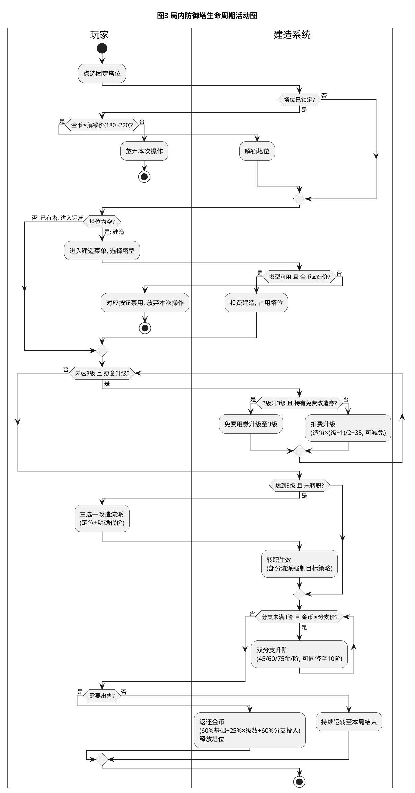
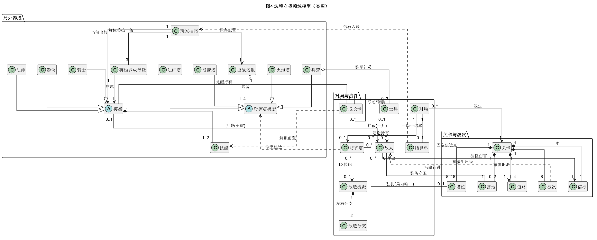
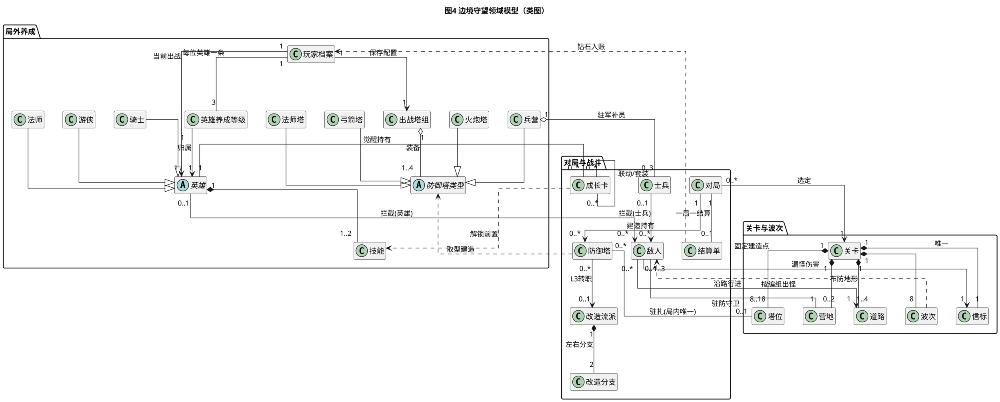

# 第1次作业 · 第一部分草稿（系统背景）

> 状态：初稿待组内审阅。所有数值均从 v0.19 源码核对（见文末附录映射表）。
> 成员署名为占位符 `[成员姓名]`，模板要求每张活动图注明制作成员，请替换。
> 活动图源码在 `_scratch/puml/*.puml`，已渲染 PNG 可直接插入 Word。

---

## 1.1 当前系统的核心业务介绍

《边境守望》是一款单机"塔防 + 英雄操作"混合玩法游戏。玩家扮演边境守望者：在战场预设的固定塔位上建设防御塔组织防线，同时亲自操控一名英雄在场内走位、拦截敌人和施放技能，抵御沿固定道路进攻的怪物波次，守护基地信标。产品规模为三关八波：三名可操控英雄（近战重剑骑士、远程森林游侠、法术星纹法师），四类可三级成长的防御塔（弓箭塔、法师塔、火炮塔、兵营），以及随关卡演化的怪物阵容与机关机制。

三项核心设计规则贯穿全部业务。其一，英雄是可操作单位，负责拦怪、躲弹和救场；防御塔本身没有生命值，英雄倒下后 15 秒在信标处复活。其二，失败判定唯一收敛于基地信标——只有信标生命归零才判负，漏过的敌人按威胁档位扣除信标生命，首领（Boss）漏怪直接判负。其三，所有伤害明确划分为物理与法术两类，敌人分别拥有护甲与法术抗性，玩家需要据此选择塔型、改造流派与英雄构筑，形成"物理克轻甲、法术破重甲"的对抗决策。

游戏业务由"局外备战—局内防守—结算养成"闭环构成：玩家在局外用钻石升级英雄等级、配置出战塔组；进入关卡后经历八波"整备—开波—防守"循环，战斗中通过建造、升级、改造防御塔和获取局内成长不断强化防线；战斗结束按战果结算钻石回流局外，驱动下一轮养成。

核心业务流程包括：1、一局游戏的主流程（整备、开波、防守、胜负判定与结算）；2、游戏外的英雄与防御塔养成流程（英雄升级、技能解锁、塔组装备与出战校验）；3、游戏内防御塔的生命周期流程（建造、升级、流派改造、出售）。辅助流程还包括营地攻防、第三关吊桥改道与破障奇袭等关卡机制。

---

## 1.2 当前系统的业务流程

### 1.2.1 业务流程一：一局游戏的主流程

**流程描述**：一局游戏以整备期开始（首波 20 秒，后续每波 16 秒，下限 8 秒）。玩家在出怪口点击开波按钮：第一次点击预览本波敌人构成（重甲比例、高法抗比例、精英数量），再次点击则提前开波，按剩余整备时间比例获得至多 12 金币奖励，超时则自动开波。战斗系统按波次表延时生成敌人（前期约 0.68 秒/只，后期约 0.5 秒/只），双路关卡以"主攻方向"交替施压，第三关按路线池分配四条道路，第 8 波在队尾追加首领。防守阶段三线并行：玩家操控英雄移动、普攻、施放 Q/E 技能并拦截敌人；防御塔自动索敌开火；敌人沿固定道路推进，被英雄或士兵拦截时转入近战，否则行进直至抵达信标，按威胁档位扣除信标生命。信标生命（750）归零立即失败。每波敌人清空后记录战报并进入下一波整备；第 8 波清空即胜利。战斗中触发成长节点（英雄 2/5/8 级、营地清剿、第三关秘石节点）会暂停并弹出三选一抉择。胜负确定后系统以本局唯一流水号幂等结算：胜利 6 钻、失败按完成波次给 2~3 钻、本关首胜加 2 钻，写盘失败时允许重试保存。



完成该活动图的小组成员：[成员姓名]

<details><summary>PlantUML 源码（flow1_battle.puml）</summary>



</details>

### 1.2.2 业务流程二：游戏外的英雄与防御塔养成

**流程描述**：养成流程发生在战斗之外，围绕钻石这一唯一养成货币展开，钻石只能通过战斗结算获得。玩家从标题页进入世界地图后，先在英雄大厅完成两件事：从三名英雄中选出出战英雄；消耗钻石提升英雄养成等级（LV1→5 共四段，分别花费 2/3/5/8 钻）——升级直接带来生命与攻击加成，LV2 解锁 Q 小技能、LV4 解锁 E 大招、LV3/LV5 进一步强化职业天赋。随后在防御塔工坊查看四类塔的三级形态与 III 阶改造流派预览，并配置出战塔组（1~4 类、不可重复、至少保留一类）；其间可随时查阅成长图鉴，了解 40 张成长卡的联动与套装。最后选择关卡查看预览（波数、预计钻石奖励、敌人构成与关卡特色），系统校验出战塔组中至少一类塔在本关首波即可建造，校验通过才允许进入战斗。养成结果全部写入持久化存档，采用"写盘成功才替换内存"的事务方式；战斗结算回流的钻石驱动下一轮养成，形成局外成长闭环。



完成该活动图的小组成员：[成员姓名]

<details><summary>PlantUML 源码（flow2_meta.puml）</summary>



</details>

### 1.2.3 业务流程三：游戏内防御塔的生命周期

**流程描述**：防御塔的生命周期从玩家点选战场上的固定塔位开始。若塔位处于锁定状态，需先花金币解锁（180~220 金）。空塔位弹出建造菜单：可选塔型由"本局出战塔组、关卡配置、当前波次"三者共同决定（部分塔在特定波次后才解锁），金币不足或未解锁时对应按钮禁用；建造费用可被局内成长卡减免（至多 50%）。塔建成后可逐级升至 3 级（费用 = 造价×(级+1)/2+35，同样可减免），2 级升 3 级时可选择消耗营地奖励的免费改造券。达到 3 级必须从三个改造流派中三选一转职，每个流派有明确定位与代价（如哨戒塔射程 +50% 但攻速 −20%）；转职后开放左右两条分支、每分支 3 阶的养成（45/60/75 金/阶），双分支可同修，单塔最高 10 阶。运营期间玩家可切换目标优先策略（最快推进/最耐打），兵营类塔还可设置集结点。塔位可随时出售：按"60% 基础造价 + 25%×已升级数×造价 + 60% 分支投入"返还金币（受成长卡最高提升至 80%），释放塔位供重建。



完成该活动图的小组成员：[成员姓名]

<details><summary>PlantUML 源码（flow3_tower.puml）</summary>



</details>

---

## 1.3 领域模型

### 任务① 确定概念类：抽取关键名词并明确列出

**名词抽取与归并**（从 1.1 业务描述与 1.2 流程中抽取）：

- **归入概念类**：守望者/玩家→玩家档案；英雄（骑士/游侠/法师）→英雄及子类；技能（Q/E）→技能；弓箭塔/法师塔/火炮塔/兵营→防御塔类型及子类；出战塔组；关卡；道路；塔位；波次；信标（基地）；营地；对局（战局）；建造出的塔→防御塔；改造流派；改造分支；士兵；敌人；成长卡（觉醒卡）；结算→结算单。
- **降为属性**：金币（对局的属性）、钻石（玩家档案的属性）、精英/首领标志（敌人的属性）、伤害类型与护甲/法抗（敌人、技能、塔类型的属性）、敌人编组（波次的属性）、塔位特性与解锁价（塔位的属性）、秘石标记（成长卡的属性，仅第三关出现）、吊桥/破障/祭坛（关卡机制属性）。
- **不入模（实现/UI 层）**：投射物、伤害结算器、HUD、菜单页面、镜头、音效、导航网格。

**概念类清单（20 核心类 + 7 子类，按子域分组）**：

| 子域 | 概念类 | 一句话定义 |
| --- | --- | --- |
| 局外养成 | 玩家档案 | 钻石、英雄等级表、通关记录与设置的持久化载体 |
| 局外养成 | 英雄（抽象）→ 骑士 / 游侠 / 法师 | 可操控的守护者；三职业以继承区分 |
| 局外养成 | 英雄养成等级 | 每位英雄一条 LV1~5 记录，承载解锁与强化 |
| 局外养成 | 技能 | 英雄的 Q 小技能 / E 大招 |
| 局外养成 | 防御塔类型（抽象）→ 弓箭塔 / 法师塔 / 火炮塔 / 兵营 | 四类塔的业务类型 |
| 局外养成 | 出战塔组 | 玩家配置的 1~4 类塔组合 |
| 关卡与波次 | 关卡 | 三关配置的整体 |
| 关卡与波次 | 道路 | 敌人行进路径（1~4 条） |
| 关卡与波次 | 塔位 | 固定建造点，部分锁定待解锁 |
| 关卡与波次 | 波次 | 每关 8 波的出怪计划（含敌人编组属性） |
| 关卡与波次 | 信标 | 基地本体，唯一失败判定物 |
| 关卡与波次 | 营地 | 精英据点：守卫、光环、突袭、奖励 |
| 对局与战斗 | 对局 | 一次完整防守（run_id、金币、波次进度） |
| 对局与战斗 | 防御塔 | 建造/升级/出售生命周期的主体 |
| 对局与战斗 | 改造流派 | L3 转职的 12 种流派 |
| 对局与战斗 | 改造分支 | 每流派 2 条、各 3 阶的养成线 |
| 对局与战斗 | 士兵 | 兵营驻军，阵亡补员 |
| 对局与战斗 | 敌人 | 行进/被拦截/漏怪（精英、首领为属性） |
| 对局与战斗 | 成长卡 | 局内觉醒被动（含秘石变种），卡间联动 |
| 对局与战斗 | 结算单 | 胜负与钻石奖励，按 run_id 幂等 |

### 任务② 确定概念类之间的关系（文字描述）

**继承（2 组，7 条）**
1. 骑士、游侠、法师 ——继承→ 英雄；
2. 弓箭塔、法师塔、火炮塔、兵营 ——继承→ 防御塔类型。

**组合（7 条）**
3. 关卡 ◆— 道路：1 — 1..4；
4. 关卡 ◆— 塔位：1 — 8..18；
5. 关卡 ◆— 波次：1 — 8；
6. 关卡 ◆— 信标：1 — 1；
7. 关卡 ◆— 营地：1 — 0..2；
8. 英雄 ◆— 技能：1 — 1..2（大招由养成解锁）；
9. 改造流派 ◆— 改造分支：1 — 2。

**聚合（2 条）**
10. 出战塔组 ◇— 防御塔类型：1 — 1..4；
11. 兵营 ◇— 士兵：1 — 0..3（补员）。

**关联（双向与定向，16 条）**
12. 玩家档案 — 英雄养成等级：1 — 3（每位英雄一条，双向）；
13. 英雄养成等级 → 英雄：1 — 1（归属，定向）；
14. 玩家档案 → 英雄：1 — 1（当前出战，定向）；
15. 玩家档案 → 出战塔组：1 — 1（保存配置，定向）；
16. 对局 → 关卡：0..* — 1（选定，定向）；
17. 对局 → 防御塔：1 — 0..*（建造持有，定向）；
18. 防御塔 — 塔位：0..* — 0..1（驻扎，双向；局内每塔位至多一塔）；
19. 防御塔 → 改造流派：0..* — 0..1（L3 转职，定向）；
20. 英雄 — 成长卡：1 — 0..*（觉醒持有，双向）；
21. 成长卡 — 成长卡：自关联（联动/套装）；
22. 营地 — 敌人：1 — 1..3（驻防守卫，双向）；
23. 英雄 → 敌人：0..1 — 0..*（拦截，定向；每敌人至多一名拦截者）；
24. 士兵 → 敌人：0..1 — 0..*（拦截，定向）；
25. 敌人 → 道路：0..* — 1（沿路行进，定向）；
26. 敌人 → 信标：0..* — 1（漏怪伤害，定向）；
27. 对局 — 结算单：1 — 0..1（一局一结算，双向）。

**依赖（4 条）**
28. 波次 ..▷ 敌人：按编组出怪；
29. 防御塔 ..▷ 防御塔类型：取型建造；
30. 成长卡 ..▷ 技能：解锁前置；
31. 结算单 ..▷ 玩家档案：钻石入账（写盘成功才生效）。

### 任务③ UML 类图



图例：空心三角实线＝继承；实心菱形＝组合；空心菱形＝聚合；实线箭头＝定向关联；无箭头实线＝双向关联；虚线箭头＝依赖；线端数字＝重数。

完成该类图的小组成员：[成员姓名]

<details><summary>PlantUML 源码（domain_model.puml）</summary>



</details>

---

## 附录：关键数值与规则 → 源码位置映射（供组内核对与答辩溯源）

| 业务规则（正文引用值） | 源码位置 |
| --- | --- |
| 英雄/塔/敌人基础数值（生命、攻击、造价、赏金） | `scripts/arena/arena_definitions.gd:5-31` |
| 漏怪扣信标血档位 14~36，精英 ≥24；首领漏怪清空信标 | `arena_definitions.gd:38-41`；`arena_enemy.gd:109-110` |
| 信标 750 血；起始金币 280 | `arena_game.gd:3,45-46` |
| 整备期 20s/16s，下限 8s | `arena_game.gd:358-359` |
| 提前开波奖励按剩余时间比例、上限 12 金 | `arena_game.gd:364-373` |
| 出怪间隔 0.68s→0.5s；第 8 波追加首领 | `arena_game.gd:393-395` |
| 每波怪血 +11%、精英 ×1.65、伤害 +6%/波 | `arena_level_catalog.gd:95-122`；`arena_enemy.gd:46-47` |
| 英雄升级经验阈值 60+25×(LV-1)；觉醒节点 Lv2/5/8 | `arena_hero.gd:468-474`；`arena_hero.gd:47` |
| 局外升级价 2/3/5/8 钻；Q=LV2、E=LV4、天赋 LV3/5 | `arena_campaign.gd:7,57-58` |
| 结算：胜 6 钻、败按完成波次 2~3 钻、首胜 +2；run_id 幂等 | `arena_campaign.gd:64-75` |
| 出战塔组 1~4 类去重、部署校验（首波可建） | `arena_campaign.gd:33-49` |
| 存档原子写（tmp+rename）、校验失败锁定保留原件 | `arena_campaign.gd:94-117` |
| 塔造价 70/100/120/80；建造减免至多 50% | `arena_definitions.gd:10-15`；`arena_game.gd:293` |
| 升级价 = 造价×(级+1)/2+35；免费改造券 L2→L3 | `arena_tower.gd:74-76,132-137` |
| L3 三选一流派（含代价）；双分支各 3 阶、45/60/75 金/阶 | `arena_doctrines.gd:5-63`；`arena_tower.gd:104-121` |
| 出售返还 60% 基础+25%×级数+60% 分支（可至 80%） | `arena_tower.gd:176-183` |
| 塔位解锁价 180/220/200 | `arena_level_catalog.gd:30,47,58` |
| 拦截容量分配（英雄优先、嘲讽优先、49/78px 判定） | `arena_blocking.gd:19-71` |
| 物理护甲/法术抗性减免上限 80%、穿透与易伤 | `arena_combat.gd:4-7` |

## 渲染方式（供组员复现，Git Bash，在工程根目录执行）

```bash
"/c/Program Files/Microsoft/jdk-21.0.13.102-hotspot/bin/java.exe" -jar "C:\Users\Chen Ruizhi\PlantUML\plantuml.jar" -charset UTF-8 -tpng _scratch/puml/*.puml
```

## 待办

- [ ] 替换四处 `[成员姓名]` 占位符（三张活动图 + 领域模型类图）
- [ ] 组内审阅正文表述与数值口径（与调研报告/立项报告一致性）
- [ ] 组内审阅领域模型（1.3）概念类取舍与重数
- [ ] 定稿后填入 `第1次作业模板_领域模型_用例模型.docx`（副本在 `_scratch`）
