# 第1次作业 · 第二部分草稿（用例模型）

> 状态：2.1（6 用例口径）与 2.2（六套 SSD 及操作契约）均已完成，待组内审阅。
> 成员署名 `[成员姓名]` 占位，请替换。

---

## 2.1 用例图

### 2.1.1 识别角色

**角色：玩家（唯一角色）。**

- **角色与系统关系**：玩家是边境守望系统的唯一人类角色。局外，玩家通过"设定备战"塑造出战配置；局内，玩家通过"管理轮次""操作英雄战斗""管理防御塔"直接驱动防守进程；"管理战斗"贯穿选关开战、暂停与结算全程。系统负责响应玩家操作，并自动推进敌方进攻、塔与士兵的支援行为及胜负结算。
- **为何无其他角色**：本系统为单机离线游戏，无网络对端与外部系统。敌方不是角色——敌方 AI 是系统内部对象（领域模型中的"敌人"类），其进攻属系统自动行为；存档文件是系统内部持久化机制（领域模型中的"玩家档案"），均不设为角色。

### 2.1.2 识别用例（6 个，角色：名词、用例：动词短语）

| 编号 | 用例 | 交互场景 |
| --- | --- | --- |
| UC-01 | 设定备战 | 玩家在局外完成出战准备：在英雄大厅选择出战英雄、消耗钻石升级英雄（2/4 级解锁 Q/E 技能、3/5 级强化天赋）；在防御塔工坊预览四类塔的三级形态与 III 阶改造流派，配置 1~4 类出战塔组（不可重复、至少保留一类）；查阅成长图鉴了解 40 张成长卡及其联动与套装。所有变更写盘成功才生效。 |
| UC-02 | 管理轮次 | 玩家在对局整备期点击出怪口按钮侦察下一波敌情（敌人构成、重甲/高法抗/精英画像）；可再次点击提前开波，放弃剩余整备时间换取至多 12 金币奖励；整备超时系统自动开波。 |
| UC-03 | 操作英雄战斗 | 玩家在对局中操控英雄移动、普攻、施放 Q/E 技能并拦截敌人；在成长节点（英雄 2/5/8 级、营地清剿、第三关秘石）的暂停弹窗中三选一选择局内成长；指挥英雄清除营地守卫以解除光环压制；在第三关启停吊桥改道敌军、释放星界共鸣斩（祭坛自动运转，不占玩家操作）。 |
| UC-04 | 管理防御塔 | 玩家点选固定塔位（锁定塔位先付费解锁），选择可用塔型建造并扣减金币；将已建塔逐级升至 3 级（2→3 级可用免费改造券）；为 3 级塔三选一转职改造流派并对左右双分支逐阶养成；按需切换目标优先策略或兵营集结点；出售已建塔按公式返还金币并释放塔位。 |
| UC-05 | 调整设置 | 玩家调整音量与"减少动态"选项，保存后立即生效并写入玩家档案。 |
| UC-06 | 管理战斗 | 玩家在世界地图选择关卡查看预览（波数、预计奖励、敌情），系统通过部署校验后进入战斗；局内随时可暂停并查阅守望手册（操作说明与本局构筑）；战斗结束后查看战报与钻石入账（保存失败可重试），选择再次出战、返回地图或英雄养成。 |

**子场景归并对照**（原细粒度场景 → 6 用例，供答辩追溯）：

| 新用例 | 归并的子场景 |
| --- | --- |
| UC-01 设定备战 | 选择出战英雄、升级英雄、配置出战塔组、查阅成长图鉴 |
| UC-02 管理轮次 | 侦察敌情、提前开波 |
| UC-03 操作英雄战斗 | 操控英雄战斗、选择局内成长、清剿营地、调度关卡机关 |
| UC-04 管理防御塔 | 建造防御塔、升级防御塔、改造防御塔、出售防御塔 |
| UC-05 调整设置 | 调整游戏设置 |
| UC-06 管理战斗 | 选择关卡出战、暂停查阅手册、查看战报结算 |

### 2.1.3 用例图

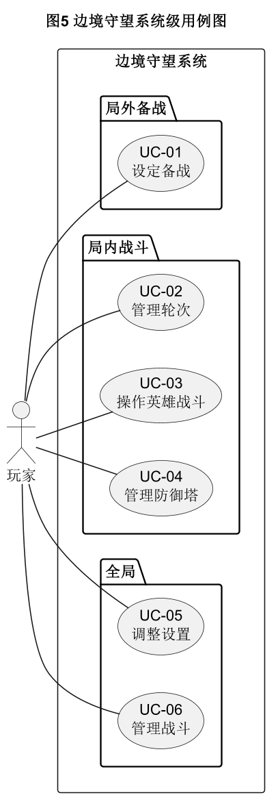

说明：一个大系统边界框"边境守望系统"；内部三个包（局外备战 / 局内战斗 / 全局）仅作业务分组，不改变 UML 语义；玩家与 6 个用例逐一关联；不含 include/extend 关系（模板注明"不要求表示子用例"，子场景以文字形式列于 2.1.2）。

完成该用例图的小组成员：[成员姓名]

PlantUML 源码（use_case_diagram.puml）

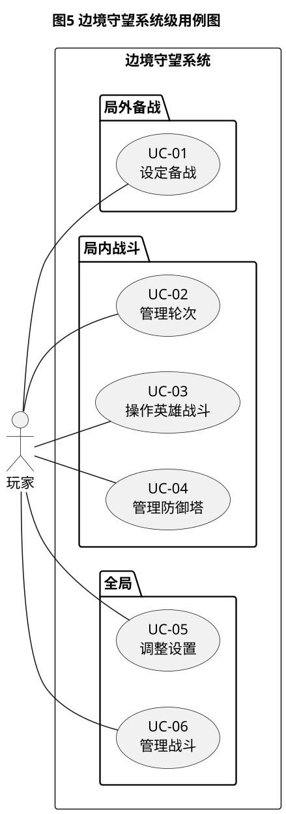

---

## 2.2 系统顺序图及操作契约

> 按定稿口径，6 个用例各配一套"SSD + 消息对应表 + 操作契约"；操作契约复用 1.3 领域模型概念类，回答模板三问（哪些业务对象被激活、哪些对象建立关联、哪些属性改变含永久保存）。表中编号以成稿为准。

### 2.2.1 UC-01 设定备战

**1. SSD（系统顺序图）**

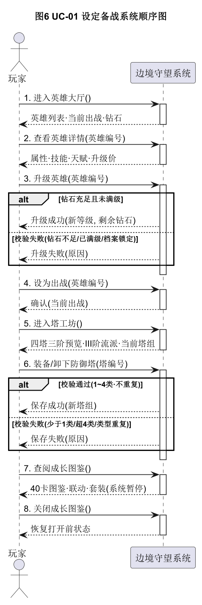

**2. 表 1 UC-01 SSD 消息对应表**

| 消息中文名 | 消息可编程名称 | 参数列表（P1, P2, …Pn） |
| --- | --- | --- |
| 进入英雄大厅 | EnterHeroHall | 无 |
| 返回 | Return | HeroList, SelectedHeroId, Gems |
| 查看英雄详情 | ViewHero | HeroId |
| 返回 | Return | Stats, Skills, Passive, UpgradePrice |
| 升级英雄 | UpgradeHero | HeroId |
| 返回（成功） | Return | NewLevel, GemsLeft |
| 返回（失败） | Return | ErrorReason |
| 设为出战 | SetSelectedHero | HeroId |
| 返回 | Return | OK |
| 进入塔工坊 | EnterTowerWorkshop | 无 |
| 返回 | Return | TowerPreviews, DoctrinePreviews, CurrentLoadout |
| 装备/卸下防御塔 | ToggleTower | TowerId |
| 返回（成功） | Return | NewLoadout |
| 返回（失败） | Return | ErrorReason |
| 查阅成长图鉴 | OpenPerkCodex | 无 |
| 返回 | Return | PerkCodex(40 卡, 联动, 套装) |
| 关闭成长图鉴 | ClosePerkCodex | 无 |
| 返回 | Return | OK（恢复原暂停状态） |

**3. 表 2 UC-01 操作契约**（模板表 3 格式：全部消息合表；如老师要求表 2 逐条标准格式可切换）

| 用例名称：UC-01 设定备战 | 消息 | 操作契约（前置条件 / 后置条件） |
| --- | --- | --- |
| | EnterHeroHall | 前置：游戏已启动，玩家处于局外界面。后置：无对象创建、无关联建立、无属性变更；系统读取玩家档案与三份英雄养成等级，仅返回展示信息。 |
| | ViewHero(HeroId) | 前置：HeroId 为合法英雄标识。后置：无状态变更，仅返回该英雄属性、技能解锁状态、天赋与升级价。 |
| | UpgradeHero(HeroId) | 前置：玩家档案未锁定；该英雄养成等级 <5；钻石 ≥ 当前升级价（2/3/5/8 钻）。后置：① 该英雄的"英雄养成等级"对象被激活，等级属性 +1；② 派生状态随之改变——等级达 2/4 级时对应技能解锁、达 3/5 级时天赋强化档位提升；③ 玩家档案的钻石属性扣减升级价；等级与钻石变更原子写入存档（tmp+rename，写盘成功才提交内存）——**永久保存**；失败则整笔不生效并返回失败原因。 |
| | SetSelectedHero(HeroId) | 前置：HeroId 为合法英雄标识；玩家档案未锁定。后置：① 玩家档案对象被激活；② 档案与所选英雄建立"当前出战"关联，原关联解除；③ selected_hero 属性变更——**永久保存**（原子写）。 |
| | EnterTowerWorkshop | 前置：玩家处于局外界面。后置：无状态变更；仅返回四类塔三阶预览、III 阶流派说明与当前出战塔组。 |
| | ToggleTower(TowerId) | 前置：玩家档案未锁定；卸下时塔组剩余 ≥1 类；装备时塔组 ≤4 类且不含重复类型。后置：① "出战塔组"对象被激活；② 出战塔组与目标防御塔类型的装备关联建立（或解除）；③ 塔组成员属性变更——**永久保存**（原子写）。 |
| | OpenPerkCodex | 后置：系统进入暂停展示态并记忆打开前暂停状态；无业务对象创建、关联或属性变更。 |
| | ClosePerkCodex | 后置：恢复图鉴打开前的暂停状态；无业务对象创建、关联或属性变更。 |

完成该 SSD 与契约的小组成员：[成员姓名]

PlantUML 源码（ssd_uc01.puml）

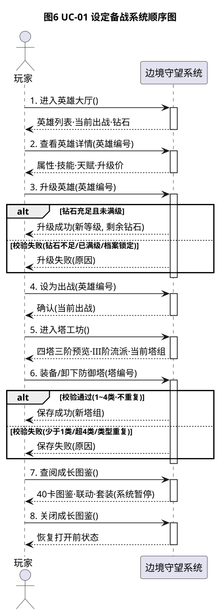

### 2.2.2 UC-02 管理轮次

**1. SSD（系统顺序图）**

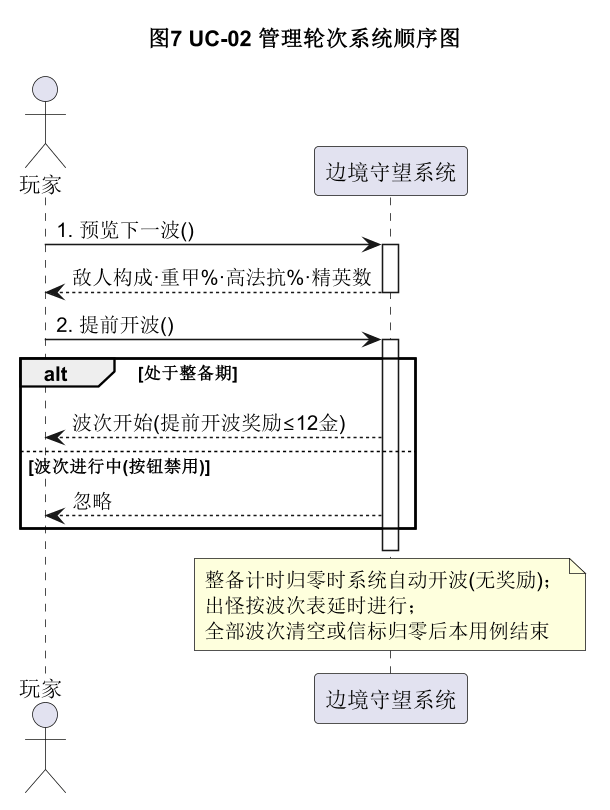

**2. 表 3 UC-02 SSD 消息对应表**

| 消息中文名 | 消息可编程名称 | 参数列表（P1, P2, …Pn） |
| --- | --- | --- |
| 预览下一波 | PreviewWave | 无 |
| 返回 | Return | EnemyKinds, HeavyPct, HighResPct, EliteCount |
| 提前开波 | StartWaveEarly | 无 |
| 返回（成功） | Return | BonusGold(≤12), WaveNumber |
| 返回（忽略） | Return | 无（非整备期，按钮禁用） |

**3. 表 4 UC-02 操作契约**

| 用例名称：UC-02 管理轮次 | 消息 | 操作契约（前置条件 / 后置条件） |
| --- | --- | --- |
| | PreviewWave | 前置：对局进行中且处于整备期；系统未暂停。后置：无对象创建、关联建立或属性变更；系统读取波次对象的敌人编组与难度画像（重甲%/高法抗%/精英数）仅作展示；预览标记为界面态。 |
| | StartWaveEarly | 前置：对局进行中且处于整备期；本波奖励未领取。后置：① 系统生成出怪计划（延时队列；敌人对象随出怪时刻逐一创建并与所分配道路建立"沿路行进"关联，未破障时第四路并入前三路）；② 若第 8 波且本关有首领，队尾追加首领；③ 营地对象按波次激活（第 2 波守卫出生）、第 4 波起逾期全场压制、第 5 波未清则标记突袭；④ 对局金币属性增加提前开波奖励（按剩余时间比例，≤12 金，领取后标记防重复）；⑤ 整备期结束，切换为出怪期。以上均为局内属性，不入玩家档案。 |

完成该 SSD 与契约的小组成员：[成员姓名]

PlantUML 源码（ssd_uc02.puml）

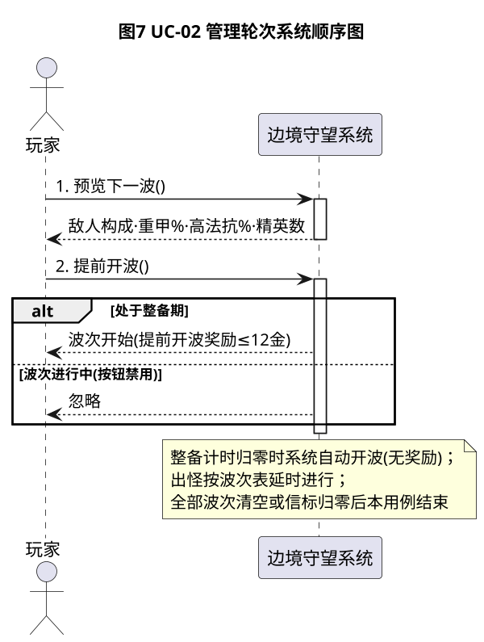

### 2.2.3 UC-03 操作英雄战斗

**1. SSD（系统顺序图）**

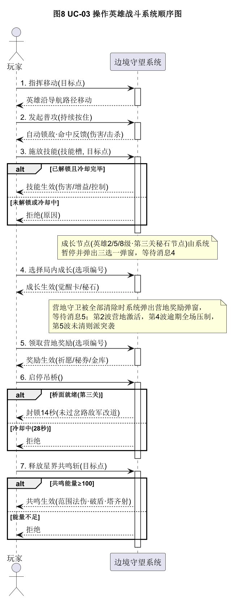

**2. 表 5 UC-03 SSD 消息对应表**

| 消息中文名 | 消息可编程名称 | 参数列表（P1, P2, …Pn） |
| --- | --- | --- |
| 指挥移动 | CommandMove | TargetPoint |
| 返回 | Return | HeroState(Position) |
| 发起普攻 | BeginAttack | 无（持续按住） |
| 返回 | Return | HitFeedback(Damage / Kill) |
| 施放技能 | CastSkill | SkillSlot(Q/E), TargetPoint |
| 返回（成功） | Return | SkillEffect |
| 返回（失败） | Return | ErrorReason |
| 选择局内成长 | ChoosePerk | OptionId |
| 返回 | Return | GrowthApplied |
| 领取营地奖励 | ChooseCampReward | OptionId(祈愿/秘券/金库) |
| 返回 | Return | RewardApplied |
| 启停吊桥 | ToggleBridge | 无 |
| 返回（成功） | Return | BridgeState(封锁14秒) |
| 返回（拒绝） | Return | Cooldown(28秒) |
| 释放星界共鸣斩 | CastResonance | TargetPoint |
| 返回（成功） | Return | ResonanceEffect |
| 返回（拒绝） | Return | InsufficientEnergy |

**3. 表 6 UC-03 操作契约**

| 用例名称：UC-03 操作英雄战斗 | 消息 | 操作契约（前置条件 / 后置条件） |
| --- | --- | --- |
| | CommandMove(TargetPoint) | 后置：英雄对象位置沿导航路径属性随时间改变（局内，不入档）；无对象创建或关联变更。 |
| | BeginAttack | 后置：① 射程内最近敌人被锁定为目标（临时关联）；② 命中时敌人生命属性按物理/法术与抗性扣减，伤害统计归属英雄；③ 击杀时敌人对象销毁、对局金币与英雄经验增加；④ 经验达阈值时英雄局内等级 +1（2/5/8 级触发成长抉择队列，见消息 4）。均不入档。 |
| | CastSkill(SkillSlot, TargetPoint) | 前置：技能已由养成等级解锁（Q=LV2、E=LV4）；冷却完毕；英雄未倒下。后置：① 技能效果对象创建（范围伤害/增益/弹幕，局内临时）；② 敌人生命与控制状态（眩晕/减速/易伤）属性改变；③ 对应技能冷却计时启动。不入档。 |
| | ChoosePerk(OptionId) | 前置：成长抉择弹窗已打开；OptionId 在三候选中。后置：① 觉醒卡与英雄建立觉醒关联（直接置满阶并觉醒，效果 ×1.25）；第三关则英雄秘石集新增一枚秘石标记（一局至多 3 枚）；② 英雄派生属性（伤害/生命/冷却/攻速等）整体重算；③ 系统解除暂停。局内成长不写入玩家档案（不入档）。 |
| | ChooseCampReward(OptionId) | 前置：该营地守卫全部清除且奖励未领取。后置：① 营地对象状态→已清剿；② 按选项生效——星界祈愿：英雄经验 +160、生命回复 40%、第三关另加共鸣与祭坛充能 35%（非第三关改为开启一次觉醒三选一）；防线秘券：对局改造券 +1；军备金库：对局金币 +100；③ 奖励标记置位防重复。不入档。 |
| | ToggleBridge | 前置：第三关且存在吊桥机关；未封锁；冷却归零。后置：① 吊桥状态=封锁 14 秒、冷却 28 秒启动；② 未过岔点的指定道路敌人行进曲线关联改挂绕行曲线（已过岔点者保持原曲线，禁止瞬移）；③ 导航网格局部重建。不入档。 |
| | CastResonance(TargetPoint) | 前置：第三关（秘石模式）；共鸣能量≥100。后置：① 范围内敌人生命与屏障属性扣减（法术伤害、屏障减半）；② 范围内防御塔各追加一次协同齐射；③ 共鸣能量归零、释放计数 +1；④ 持有"共鸣过载"秘石标记时小技能冷却刷新。不入档。 |

完成该 SSD 与契约的小组成员：[成员姓名]

PlantUML 源码（ssd_uc03.puml）

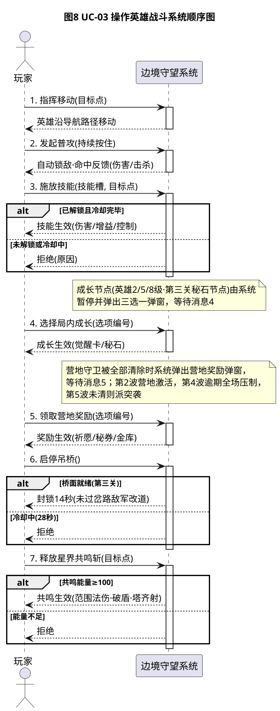

### 2.2.4 UC-04 管理防御塔

**1. SSD（系统顺序图）**

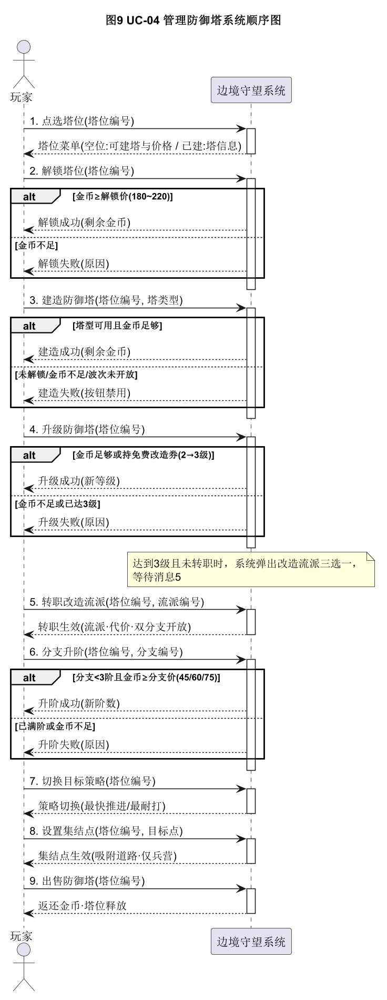

**2. 表 7 UC-04 SSD 消息对应表**

| 消息中文名 | 消息可编程名称 | 参数列表（P1, P2, …Pn） |
| --- | --- | --- |
| 点选塔位 | SelectTowerSite | SiteId |
| 返回 | Return | SiteMenu(锁定状态 / 可建塔与价格 / 已建塔信息) |
| 解锁塔位 | UnlockSite | SiteId |
| 返回（成功） | Return | GoldLeft |
| 返回（失败） | Return | ErrorReason |
| 建造防御塔 | BuildTower | SiteId, TowerKind |
| 返回（成功） | Return | GoldLeft |
| 返回（失败） | Return | ErrorReason(按钮禁用) |
| 升级防御塔 | UpgradeTower | SiteId |
| 返回（成功） | Return | NewLevel |
| 返回（失败） | Return | ErrorReason |
| 转职改造流派 | ChooseDoctrine | SiteId, DoctrineId |
| 返回 | Return | DoctrineApplied(双分支开放) |
| 分支升阶 | UpgradeBranch | SiteId, BranchIndex |
| 返回（成功） | Return | NewRank |
| 返回（失败） | Return | ErrorReason |
| 切换目标策略 | SwitchTargetMode | SiteId |
| 返回 | Return | TargetMode(First / Strongest) |
| 设置集结点 | SetRallyPoint | SiteId, TargetPoint |
| 返回 | Return | RallyPoint(吸附道路) |
| 出售防御塔 | SellTower | SiteId |
| 返回 | Return | RefundGold |

**3. 表 8 UC-04 操作契约**

| 用例名称：UC-04 管理防御塔 | 消息 | 操作契约（前置条件 / 后置条件） |
| --- | --- | --- |
| | SelectTowerSite(SiteId) | 后置：无对象变更；选中塔位为界面态；返回该塔位建造菜单或已建塔信息。 |
| | UnlockSite(SiteId) | 前置：塔位属本关锁定集；对局金币≥解锁价（180/200/220）。后置：① 塔位解锁状态属性→已解锁；② 对局金币扣减解锁价。不入档。 |
| | BuildTower(SiteId, TowerKind) | 前置：对局进行中；塔位空且已解锁；塔型∈出战塔组∩本关配置∩当前波次已解锁；金币≥造价（可减免至多 50%）。后置：① **创建防御塔对象**；② 防御塔与塔位建立驻扎关联（局内每塔位至多一塔）；③ 防御塔与所选防御塔类型建立取型关联；④ 若为兵营类型，创建 0..3 名士兵对象建立聚合；⑤ 对局金币扣减造价；⑥ 导航网格局部重建；⑦ 建塔计数 +1。不入档。 |
| | UpgradeTower(SiteId) | 前置：塔级<3；金币≥升级价（造价×(级+1)/2+35，可减免）或 2→3 级时持免费改造券。后置：① 防御塔等级 +1；② 金币扣减或券 −1；③ 达 3 级时进入待转职态（弹流派三选一）；④ 兵营士兵属性同步刷新。不入档。 |
| | ChooseDoctrine(SiteId, DoctrineId) | 前置：塔为 3 级且未转职；流派属本塔型候选。后置：① 改造流派与防御塔建立转职关联（0..1）；② 该流派两条改造分支实例化（各 0..3 阶）；③ 部分流派强制变更目标策略。不入档。 |
| | UpgradeBranch(SiteId, BranchIndex) | 前置：已转职；该分支<3 阶；金币≥分支价（45/60/75）。后置：① 改造分支阶数 +1，流派效果按增量叠加；② 金币扣减；③ 士兵属性同步。不入档。 |
| | SwitchTargetMode(SiteId) | 前置：流派未强制目标。后置：防御塔目标策略属性在"最快推进/最耐打"间切换。不入档。 |
| | SetRallyPoint(SiteId, TargetPoint) | 前置：塔为兵营；目标点距塔 ≤145 且吸附最近道路点。后置：兵营集结点属性变更，士兵驻位重排。不入档。 |
| | SellTower(SiteId) | 前置：塔未销毁。后置：① 防御塔对象销毁，与塔位的驻扎关联解除（塔位释放复用）；② 对局金币增加返还额（60% 基础 + 25%×已升级数×造价 + 60% 分支投入，受成长卡最高至 80%）；③ 导航网格重建。不入档。 |

完成该 SSD 与契约的小组成员：[成员姓名]

PlantUML 源码（ssd_uc04.puml）

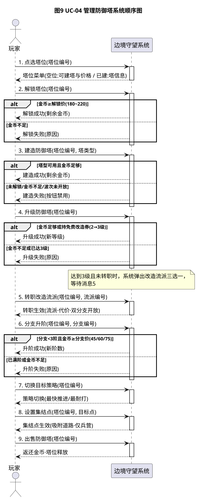

### 2.2.5 UC-05 调整设置

**1. SSD（系统顺序图）**

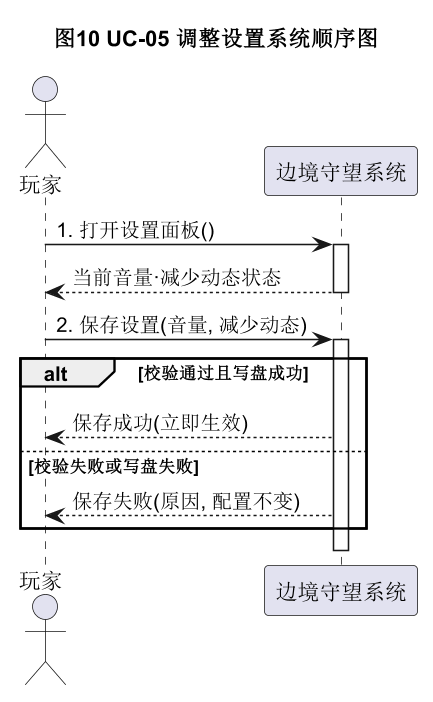

**2. 表 9 UC-05 SSD 消息对应表**

| 消息中文名 | 消息可编程名称 | 参数列表（P1, P2, …Pn） |
| --- | --- | --- |
| 打开设置面板 | OpenSettings | 无 |
| 返回 | Return | Volume, ReducedMotion |
| 保存设置 | SaveSettings | Volume, ReducedMotion |
| 返回（成功） | Return | OK(立即生效) |
| 返回（失败） | Return | ErrorReason(配置不变) |

**3. 表 10 UC-05 操作契约**

| 用例名称：UC-05 调整设置 | 消息 | 操作契约（前置条件 / 后置条件） |
| --- | --- | --- |
| | OpenSettings | 后置：无对象变更；返回当前音量与"减少动态"状态。 |
| | SaveSettings(Volume, ReducedMotion) | 前置：音量为 0~1 的有限数；"减少动态"为布尔值。后置：① 玩家档案的音量与减少动态属性变更——**永久保存**（原子写，写盘失败则配置不变并提示）；② 音频总线音量立即生效；③ 界面动态效果开关立即生效。 |

完成该 SSD 与契约的小组成员：[成员姓名]

PlantUML 源码（ssd_uc05.puml）

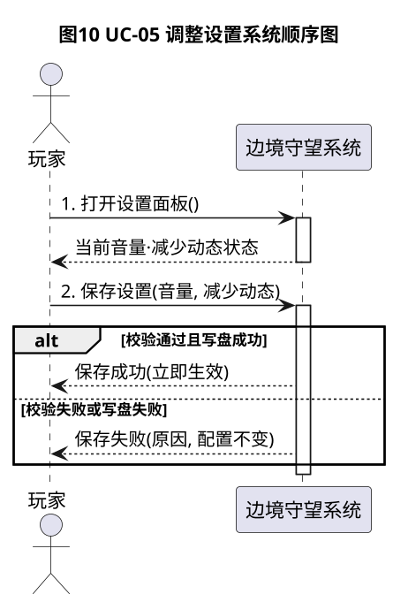

### 2.2.6 UC-06 管理战斗

**1. SSD（系统顺序图）**

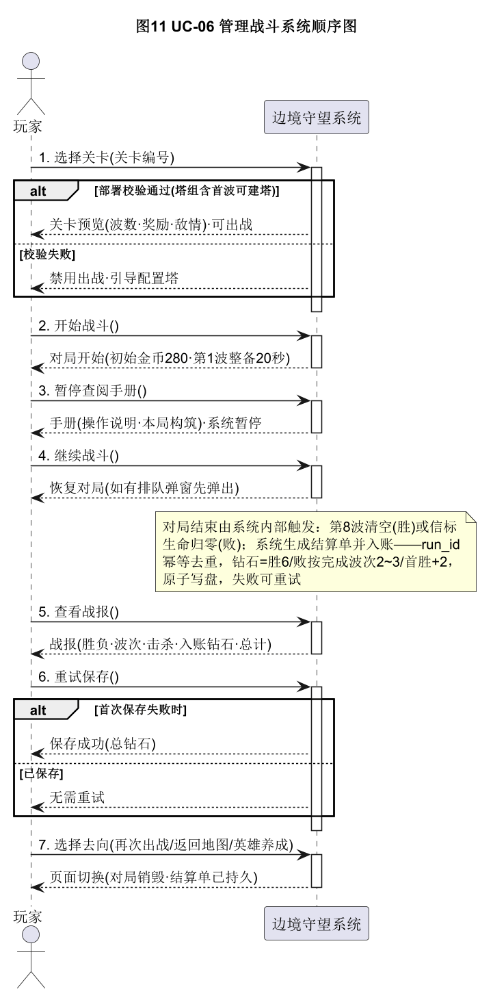

**2. 表 11 UC-06 SSD 消息对应表**

| 消息中文名 | 消息可编程名称 | 参数列表（P1, P2, …Pn） |
| --- | --- | --- |
| 选择关卡 | SelectStage | StageId |
| 返回（校验通过） | Return | StagePreview(Waves, Reward, EnemyPreview), DeployOK |
| 返回（校验失败） | Return | DeployCheckFailed(引导配置塔) |
| 开始战斗 | DeployStage | 无 |
| 返回 | Return | RunStarted(Gold=280, Wave=1/8) |
| 暂停查阅手册 | PauseOpenManual | 无 |
| 返回 | Return | ManualContent(系统暂停) |
| 继续战斗 | ResumeBattle | 无 |
| 返回 | Return | OK(排队弹窗先弹出) |
| 查看战报 | ViewResult | 无 |
| 返回 | Return | BattleReport(Won, Waves, Kills, GemsGained, GemsTotal) |
| 重试保存 | RetrySettlement | 无 |
| 返回 | Return | OK(GemsTotal) |
| 选择去向 | ChooseNext | Action(再次出战 / 返回地图 / 英雄养成) |
| 返回 | Return | PageSwitched |

**3. 表 12 UC-06 操作契约**

| 用例名称：UC-06 管理战斗 | 消息 | 操作契约（前置条件 / 后置条件） |
| --- | --- | --- |
| | SelectStage(StageId) | 前置：StageId ∈ 三关合法编号。后置：无对象变更；返回关卡预览与部署校验结果（出战塔组中至少一类塔本关首波可建）。 |
| | DeployStage | 前置：部署校验通过。后置：① **创建对局对象**（生成唯一 run_id 流水号）；② 对局与所选关卡建立"选定"关联；③ 对局快照出战塔组（重开沿用快照）；④ 初始金币 280、信标满血 750、第 1 波整备 20 秒；⑤ 创建英雄战斗实例于出生信标；⑥ 实例化关卡的道路、塔位（含锁定态）、营地与祭坛组合；⑦ 构建导航网格。对局对象局内存在不入档（仅结算单持久）。 |
| | PauseOpenManual | 后置：系统暂停；手册展示操作说明与本局构筑摘要；无业务对象变更。 |
| | ResumeBattle | 后置：解除暂停；如有排队的成长/奖励弹窗先弹出再恢复；无业务对象变更。 |
| | （系统事件）对局结束生成结算单 | 非玩家消息：第 8 波清空（胜）或信标生命归零（败）时系统触发。① **创建结算单对象**（胜负、完成波次、run_id）；② 玩家档案钻石属性增加（胜 6 / 败按完成波次 2~3 / 本关首胜 +2），胜利时通关记录置位——**永久保存**（原子写，失败可重试；run_id 幂等，重复结算金额为 0）。 |
| | ViewResult | 后置：无对象变更；展示胜负、抵达波次、击杀数、英雄等级、建塔数、清营数与钻石入账。 |
| | RetrySettlement | 前置：结算首次写盘失败。后置：结算单重新原子写盘——**永久保存**；成功后刷新战报；run_id 幂等防重复入账。 |
| | ChooseNext(Action) | 前置：战报已展示。后置：按 Action——再次出战：以同英雄与塔组快照重建新对局；返回地图：回世界地图；英雄养成：打开英雄大厅；原对局对象销毁（结算单已持久）。 |

完成该 SSD 与契约的小组成员：[成员姓名]

PlantUML 源码（ssd_uc06.puml）

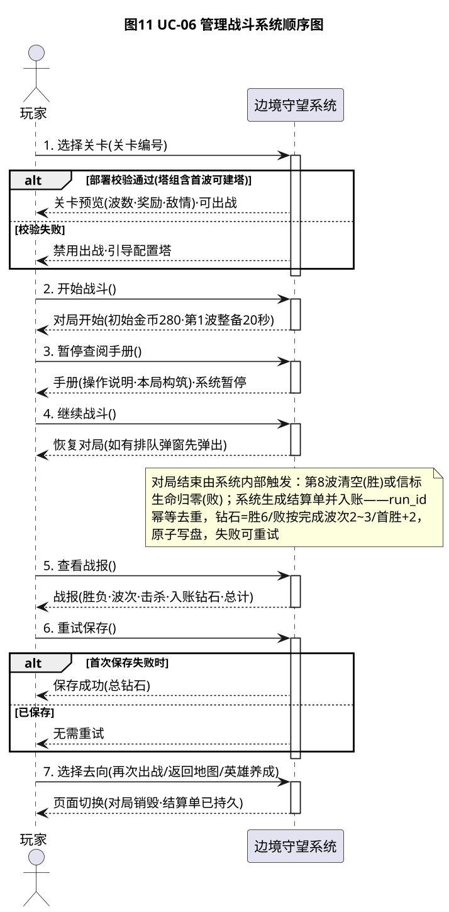

## 待办

- [ ] 替换 `[成员姓名]` 占位符（用例图 + 6 套 SSD 与契约）
- [ ] 确认用例命名："管理轮次"为动词化调整（原"轮次管理"），如老师不要求可改回
- [ ] 组内审阅 2.1 三小节与 2.2 六套 SSD/契约
- [ ] 工作量统计表（模板第 3 章）由组内如实填写
